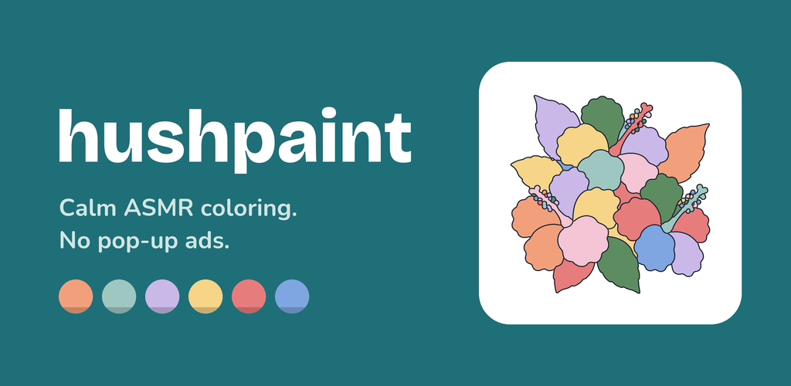
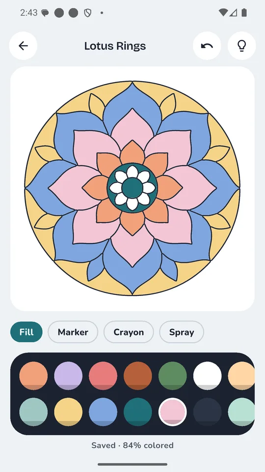
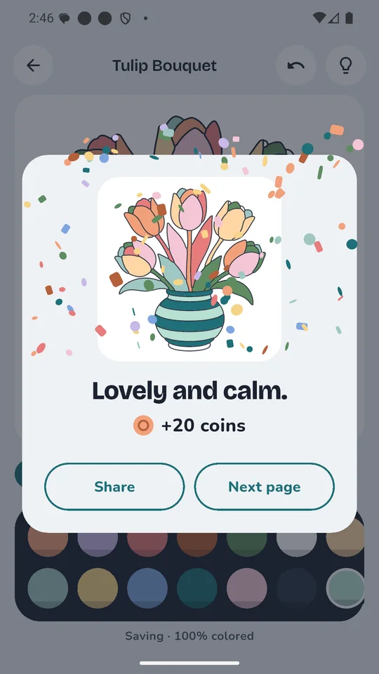
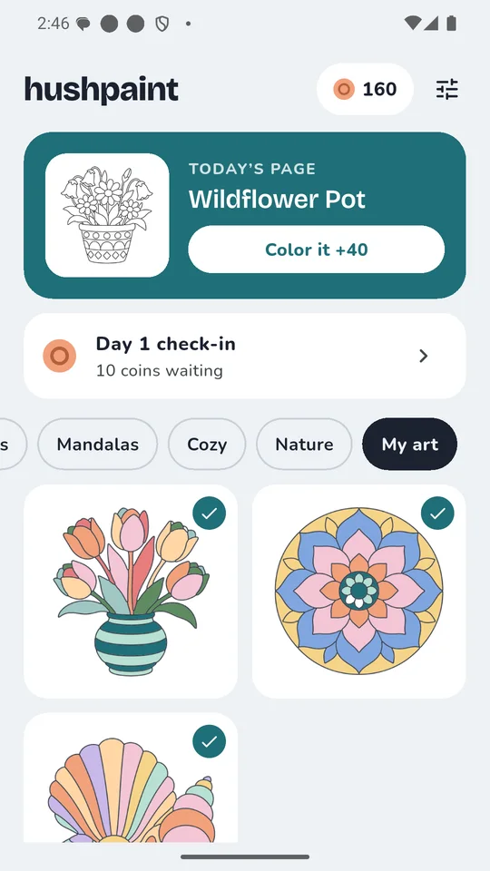

# Hushpaint: ASMR Coloring

A calm coloring app for Android with soft ASMR sounds. Tap to fill, draw with marker, crayon or spray, and never sit through a pop-up ad.

  
  
  

## What it does

- **Tap to fill.** Pick a color and tap any area. The paint blooms in.
- **Draw freely.** Marker, crayon and spray strokes stay under the lines. Pinch to zoom, undo anything.
- **72 original pages** in four sets (Flowers, Mandalas, Cozy, Nature), plus a new page every day.
- **Soft sounds.** A water-drop fill, a felt marker, a waxy crayon. Turn them off whenever you like.
- **No pop-up ads.** A small banner sits on the home screen only. Reward videos are always optional.
- **Works offline** and autosaves every stroke. Your paintings stay on your phone.
- **No purchases.** Coins come from coloring, the daily check-in and finishing pages.
- Light and dark themes, no flashing effects, and it follows your phone's reduce-motion setting.

## Links

- Website: <https://hushpaint.pages.dev/>
- Privacy policy: <https://hushpaint.pages.dev/privacy/>
- Trailer: <https://youtu.be/CG-l_EQA9M8>
- Support: anithabheesetty@gmail.com

---

This repository is the product page for Hushpaint. The app's source code isn't published here. © 2026 Hushpaint, all rights reserved.
